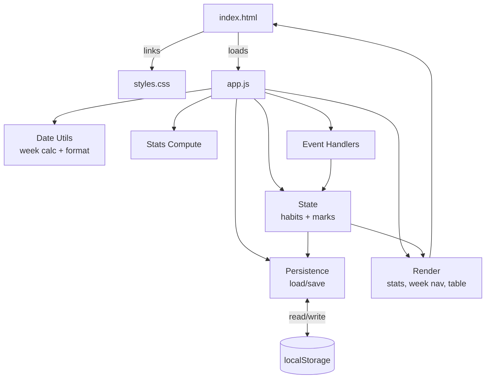
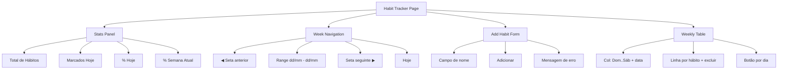

# Design Document

## Overview

The Habit_Tracker_App is a single-page, client-side web application built with plain HTML, CSS, and JavaScript. It has no build step, no frameworks, and no external dependencies, so it runs entirely offline by opening `index.html` directly in a browser.

The app lets a user register habits, see them laid out across a week (Sunday to Saturday), toggle a daily completion mark per habit, and read a statistics panel summarizing progress. All data persists in the browser's `localStorage`.

The interface is in Portuguese, dates use the Brazilian `dd/mm` format, and week day abbreviations are `Dom`, `Seg`, `Ter`, `Qua`, `Qui`, `Sex`, `Sáb`.

This design targets the simplest implementation that satisfies the approved requirements, with no features beyond those listed.

### Design Decisions and Rationale

- **Three files (`index.html`, `styles.css`, `app.js`)**: the user explicitly required this separation. HTML holds structure, CSS holds presentation, JS holds all logic.
- **Single state object persisted under one localStorage key**: one read on load, one write per change — simplest and atomic for an MVP.
- **Full re-render on each state change**: the DOM is small, so rebuilding the affected sections from state is simpler and less error-prone than incremental DOM patching.
- **Marks keyed by full ISO date (`YYYY-MM-DD`)**: navigation shows the correct marks for each week, and a habit is markable on today and any past day regardless of creation date. Cell buttons for future days are disabled.
- **Stats always computed from the Current_Week (today's week)**: per the explicit constraint and Requirement 4.5, the Navigated_Week only controls which marks are visible/editable in the table.
- **Native `confirm()` for deletion**: simplest offline confirmation mechanism with zero extra code.
- **No automated tests**: the user explicitly excluded any test tooling; validation is manual in the browser.

## Architecture

The application is a vanilla-JS single page with no build pipeline. `index.html` is the entry point and links `styles.css` and `app.js`. All runtime logic lives in `app.js`, organized as a set of plain functions grouped by responsibility.



### Logical layers in `app.js`

1. **State** — a single in-memory object holding habits and marks, plus the `navigatedWeekStart` date used for the table view.
2. **Persistence** — `loadState()` reads from localStorage; `saveState()` writes the current state.
3. **Date Utils** — pure functions for week-start calculation, week-day enumeration, and date formatting.
4. **Stats Compute** — pure functions deriving the four statistics from state and the current week.
5. **Render** — functions that rebuild the stats panel, week navigation, and weekly table from state.
6. **Event Handlers** — wire user interactions (add, delete, toggle mark, navigate weeks, go to today) to state mutations, persistence, and re-render.

## Components and Interfaces

### UI Components

The page is structured top-to-bottom as four regions, all described in `index.html` and styled in `styles.css`.



1. **Stats Panel** (`#stats`) — four read-only values:
   - Total de Hábitos (total registered habits)
   - Marcados Hoje (count of habits marked today)
   - % Hoje (today completion percentage)
   - % Semana Atual (current week completion percentage)
2. **Week Navigation** (`#week-nav`) — shows the navigated week range `dd/mm - dd/mm`, a previous-week arrow, a next-week arrow, and a "Hoje" (Today) button.
3. **Add Habit Form** (`#add-form`) — a text input, an "Adicionar" button, and an inline error message element shown only for invalid input.
4. **Weekly Table** (`#weekly-table`) — a header row with 7 day columns (Sun→Sat) plus one row per habit. Each habit row has the habit name, a delete button, and 7 cell buttons (one per day). The today column is highlighted while the Navigated_Week equals the Current_Week.

### JavaScript Interfaces (functions in `app.js`)

**State & Persistence**
- `loadState(): AppState` — parse localStorage; return empty state if absent or invalid.
- `saveState(state): void` — serialize state to localStorage (wrapped in try/catch).

**Date Utils (pure)**
- `getWeekStart(date): Date` — returns the Sunday (00:00) of the week containing `date`.
- `getWeekDays(weekStart): Date[]` — returns the 7 dates Sunday→Saturday.
- `dateKey(date): string` — returns `YYYY-MM-DD` used as the mark key.
- `formatDDMM(date): string` — returns `dd/mm` for display (e.g., `19/01`).
- `formatDayHeader(date, abbr): string` — returns `Sáb 19` style header label.

**Stats (pure)**
- `computeStats(state, currentWeekStart): StatsResult` — returns `{ total, markedToday, pctToday, pctWeek }`, always computed from the current week.

**Render**
- `renderStats(state, currentWeekStart): void` — fills the four stats values.
- `renderWeekNav(navigatedWeekStart): void` — fills the range label.
- `renderTable(state, navigatedWeekStart, currentWeekStart): void` — rebuilds the table, applying today-column highlight, mark states, and disabling cell buttons for future days.
- `renderAll(): void` — calls the three render functions.

**Event Handlers**
- `onAddHabit(): void` — validate name; create habit or show error; save; render.
- `onDeleteHabit(id): void` — `confirm()`; on yes remove habit and its marks; save; render.
- `onToggleMark(habitId, date): void` — flip the mark; save; render. Future dates are ignored (defensive guard).
- `onPrevWeek(): void` — `navigatedWeekStart -= 7 days`; render table.
- `onNextWeek(): void` — `navigatedWeekStart += 7 days`; render table.
- `onToday(): void` — `navigatedWeekStart = currentWeekStart`; render table.

## Data Models

All state is persisted under a single localStorage key.

**localStorage key:** `habit-tracker:data`

**Stored shape:**
```json
{
  "habits": [
    { "id": "l3f9a2", "name": "Beber água" }
  ],
  "marks": {
    "l3f9a2": {
      "2025-01-19": true
    }
  }
}
```

- **habits**: an array of habit objects.
  - `id`: unique string identifier generated by `Date.now().toString(36)` concatenated with a short random suffix (`Math.random().toString(36).slice(2, 8)`). No dependency on `crypto.randomUUID()`.
  - `name`: the habit name, 1–50 characters, stored as entered (whitespace is trimmed before validation/storage).
- **marks**: an object keyed by habit `id`. Each value is an object keyed by ISO date string `YYYY-MM-DD`; the presence of a key with value `true` means the habit is marked complete for that day. Deleting a habit removes its entry from `marks`.

**In-memory runtime state (not persisted):**
- `navigatedWeekStart`: a `Date` set to the Sunday midnight of the week currently shown in the table. Initialized to the Current_Week's start on load and on "Hoje".

**Why ISO date keys:** unambiguous ordering and lookup, independent of display locale. Display formatting (`dd/mm`) is applied only at render time.

**Date key generation (`dateKey`):** built from local date parts (`getFullYear()`, `getMonth()+1`, `getDate()`) zero-padded, so it matches the user's local calendar day, not UTC. Week and "today" comparisons are also done on local-midnight `Date` values.

## Error Handling

- **Invalid habit name (Requirement 1.2):** when the submitted name is empty after trimming, or longer than 50 characters, no habit is created. The error message element is shown and the input is given an error style. A valid submission hides the error and clears the input.
- **Delete confirmation (Requirements 1.3–1.5):** deletion uses the native `confirm()` dialog. Proceeding removes the habit and its marks; canceling leaves everything unchanged. No custom modal is needed.
- **localStorage failures:** `saveState()` wraps the write in `try/catch`. If storage is full or unavailable, the error is ignored (best-effort for an MVP) and the in-memory state remains the source for the current session. `loadState()` wraps the read/parse in `try/catch` and falls back to an empty state on any parse error, so a corrupt entry never breaks the page.
- **Empty state (Requirements 2.3, 4.6):** when no habits exist, the table shows only its header row, and all stats display `0`. No error message is shown.
- **Future-day cells (Requirement 3.11):** cell buttons for dates after today are rendered with a `disabled` class, greyed out, and have no click listener. `onToggleMark` also ignores future dates as a defensive guard.

## Correctness Properties

This feature is not suitable for property-based testing. The Habit_Tracker_App is a UI-rendering, simple CRUD app whose persistence is a localStorage side-effect, with no build step and no test toolchain permitted (validation is manual in the browser). There are no pure-function boundaries with a wide, meaningful input space that would benefit from randomized property tests over a few example-based checks. Accordingly, no correctness properties are defined and validation is handled through manual browser testing described in the Testing Strategy.

## Testing Strategy

There are no automated tests. The user explicitly excluded any test framework, Node.js tooling, package files, and verification scripts. Validation is performed manually in the browser by opening `index.html` and exercising the scenarios below, each mapped to the acceptance criteria it covers.

### Manual Test Scenarios

**Habit registration and deletion (Requirement 1)**
1. Type a valid name (e.g., "Beber água") and press Enter/click Adicionar → a new row appears in the table and persists after reload.
2. Submit an empty (or whitespace-only) name → no habit is created; the error indication shows.
3. Submit a name longer than 50 characters → no habit is created; the error indication shows.
4. Click a habit's delete button → a confirm dialog appears; confirm → the habit and its marks are removed and persist as removed after reload.
5. Click delete and cancel → the habit and its marks remain unchanged.

**Data persistence (Requirement 2)**
6. Add habits and toggle marks, then reload the page → habits and marks are restored exactly.
7. Clear localStorage and reload → empty table and empty (zero) stats, no error message.

**Weekly view (Requirement 3)**
8. Open the app → table shows the Current_Week, today's column is highlighted.
9. Verify column headers read `Dom`, `Seg`, `Ter`, `Qua`, `Qui`, `Sex`, `Sáb` with the correct day numbers (e.g., `Dom 19`).
10. Verify the week range label shows `dd/mm - dd/mm` (e.g., `19/01 - 25/01`).
11. Click a cell → the mark toggles on/off and the state persists after reload.
12. Click the previous-week arrow → the table shows the previous week; today's column is no longer highlighted.
13. Click the next-week arrow → the table shows the next week.
14. Click "Hoje" → the table returns to the Current_Week with today's column highlighted again.
15. Navigate to another week and toggle marks → only the navigated week's marks change; marks for other weeks are unaffected.
16. On the Current_Week, verify that cell buttons for days after today appear disabled (greyed out) and do not respond to clicks.
17. Navigate to a future week → all 7 day cells are disabled and cannot be toggled.
18. Navigate to a past week → all 7 day cells are enabled and can be toggled normally.

**Statistics panel (Requirement 4)**
19. With habits present and some marked today → Total de Hábitos equals the registered count, Marcados Hoje equals the count marked today, % Hoje and % Semana Atual match hand-calculated rounded values.
20. Navigate to a different week and toggle marks in that week → the Stats Panel still reflects the Current_Week only (values do not change unless the current week is affected).
21. With habits but none marked in the current week → Marcados Hoje = 0, % Hoje = 0, % Semana Atual = 0.
22. With no habits → all stats show 0.
23. Verify percentage rounding: e.g., 2 of 3 habits marked today → % Hoje shows 67.

### Verification Approach

Each scenario is checked by visual inspection and by reloading to confirm persistence. No scripts, no Node.js, no package files are introduced.
